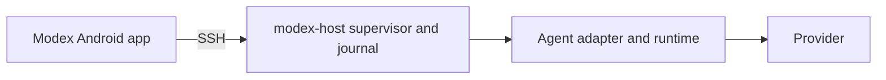

<p align="center">
  <strong><a href="README.md">English</a></strong> · <a href="README.vi.md">Tiếng Việt</a>
</p>

<p align="center"><strong>Modex</strong></p>
<h1 align="center">Your coding agents, from your phone.</h1>
<p align="center">A native Android client for working with agents on your own computer over SSH.</p>

<p align="center">
  <a href="https://github.com/warmdev17/modex/releases/tag/v0.1.0-dev.38"></a>
  <a href="https://github.com/warmdev17/modex/actions/workflows/verify.yml"></a>
</p>

> **Preview software.** Modex is under active development and is not production-ready. Current builds are development previews.

## Work with agents on your computer

Modex puts a native Android chat in front of agent runtimes installed on your Linux or macOS computer. The phone connects over SSH; the host runs the agent with your existing account and configuration. Windows host use currently requires WSL2.

- Start and continue agent conversations from Android.
- Follow streamed responses and review supported permission requests.
- Keep provider credentials and execution on the host.
- Use Codex, OpenCode, or Antigravity where the host setup and supported capabilities permit.

## Download

The current preview is [v0.1.0-dev.38](https://github.com/warmdev17/modex/releases/tag/v0.1.0-dev.38). Download the Android APK from its GitHub pre-release. The app package is `dev.modex` and requires Android 8.0 (API 26) or later. Host installation instructions and platform details are in the [installation guide](docs/install.md).

## Quick start

The dev.38 pre-release publishes the Android APK. With Go 1.23 or later installed, build the matching host tools from this checkout on Linux or macOS:

```sh
./scripts/build.sh
~/.local/bin/modex service install --workspace /absolute/path/to/project
~/.local/bin/modex service start
```

The build script adds `~/.local/bin` to supported shell startup files when needed; open a new terminal before using the shorter `modex` command.

Configure the agent's provider login and SSH public-key access on the host. In Android, add the host name/IP, port, SSH user, and the remote binary/state paths printed by `modex service install`. Import a dedicated, **unencrypted** private key that is authorized for that SSH user.

Paste the SSH server's SHA256 host-key fingerprint after verifying it on the host or through another trusted channel. For example, on a Linux host using its Ed25519 key:

```sh
ssh-keygen -lf /etc/ssh/ssh_host_ed25519_key.pub -E sha256
```

Do not trust a fingerprint learned only from an unverified network scan. See [managing Android connections](docs/mobile-development.md#managing-android-connections) and the [installation guide](docs/install.md) for the full setup and WSL2 notes.

## How it works



The SSH connection carries the app's requests and agent events. Agent execution and provider credentials stay on the host. SSH protects the transport; Modex does not claim end-to-end encryption beyond SSH.

## Runtime support

| Runtime | Current scope |
| --- | --- |
| Codex | The fullest integration, including conversations, streaming, supported approvals, history, attachments, and Codex-specific controls where available. |
| OpenCode | Chat, history, model selection, attachments, projects and form/tool state have varying support. Some Codex-specific controls and OpenCode features are unsupported; see the current [agent support matrix](docs/agents.md). |
| Antigravity | Text chat, default model, streaming, Stop, history, and one-time permissions. Attachments and steering are not supported; feature parity is not implied. |

The host's supported operations are Linux and macOS. Windows host workflows use WSL2. See [agent support](docs/agents.md) for capability detail.

## Similar projects

This is a selected, non-exhaustive map of adjacent projects. Compatibility below is what each project publicly documents as of **2026-11-27**, not a Modex interoperability test. Named support may use a dedicated integration, ACP, or a terminal path, so feature depth can differ by agent.

| Project | Highlights | Documented agent compatibility |
| --- | --- | --- |
| [T3 Code](https://github.com/pingdotgg/t3code) | Desktop, web, and mobile control plane; worktrees, Git review, remote access, and cross-agent delegation. See the telemetry note below. | Names Claude Code, Codex, Cursor, OpenCode, Grok Build, Antigravity, Kiro, Pi, Muse Code, and fx; also accepts local or registry ACP agents. |
| [Happy](https://github.com/slopus/happy) | Mobile/web/desktop clients, encrypted relay, push notifications, multiplayer sessions, and orchestration. | Direct Claude, Codex, and Grok paths; Gemini through Antigravity; OpenCode and other ACP agents through harnesses. |
| [Sesori](https://github.com/sesori-ai/sesori_apps_monorepo) | iOS/Android remote control, encrypted relay, diffs, worktrees, subagent views, notifications, and managed runtime installs. | Claude Code, Codex, OpenCode, Cursor, GitHub Copilot, Antigravity, Grok Build, DeepSeek Harness, Hermes Agent, Pi, and Oh My Pi. |
| [OpenCode Mobile](https://github.com/alvarolorentedev/opencode-mobile) | Focused iOS/Android companion with live tools, approvals, diffs, terminal, voice, and direct connection to self-hosted servers. | OpenCode only; it follows the models, providers, agents, commands, and plugins exposed by the connected OpenCode server. |
| [AndCode](https://github.com/yuga-hashimoto/and-code) | Runs coding agents locally on Android through PRoot, so on-device use needs no PC or SSH; also supports remote OpenCode. | OpenCode stable; Claude Code, Codex, and Antigravity marked beta. Remote-PC mode is documented for OpenCode. |
| [MobileFlow](https://github.com/cwx2/mobile-flow) | Phone client plus desktop agent with files, terminal, Git, local preview, relay, and self-hosted tunnel options. | ACP paths for Claude Code, Codex, Aider, Gemini CLI, GitHub Copilot, and Kiro; generic CLI tools through its terminal. |

**T3 Code telemetry note.** A [community issue](https://github.com/pingdotgg/t3code/issues/4123) challenged default-on telemetry and earlier privacy messaging; that issue was closed on November 4, 2026. T3 Code's [current telemetry documentation](https://github.com/pingdotgg/t3code/blob/main/docs/user/telemetry.md) says it sends product-usage events and relay diagnostics, documents server/desktop opt-out environment variables and mobile diagnostics toggles, and says prompts, responses, file contents, and credentials are excluded unless a user explicitly approves conversation text in an agent-feedback report. See also the [KuCoin report](https://www.kucoin.com/vi/news/flash/t3-code-telemetry-controversy-sparks-community-outcry-and-code-fixes). Review the current settings and policy yourself before using any remote agent controller with sensitive repositories.

Modex currently takes a narrower path: native Android over user-managed SSH, no required Modex account or relay, target-owned credentials, and explicit capability boundaries for each runtime. It does not yet match the broader projects above in Claude Code support, hosted remote access, push delivery, or total agent count.

## Documentation

- [Architecture](docs/architecture.md) · [Agent support](docs/agents.md)
- [Current status](docs/status.md) · [Roadmap](docs/roadmap.md)
- [All documentation](docs/README.md)
- [Installation](docs/install.md) · [Design notes](docs/design.md) · [Release process](docs/releasing.md)

## Future direction

Modex Cloud, Basic/Plus relay, Pro managed execution, push notifications, and cross-agent orchestration are future direction only. They are not available in this preview. Pricing, billing, provider-account handling, and related commercial details are undecided.

Modex has no project license yet. See the [current status](docs/status.md) for what is implemented and what remains in preview.
