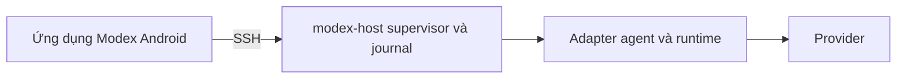

<p align="center">
  <a href="README.md">English</a> · <strong><a href="README.vi.md">Tiếng Việt</a></strong>
</p>

<p align="center"><strong>Modex</strong></p>
<h1 align="center">Dùng agent lập trình trên điện thoại.</h1>
<p align="center">Ứng dụng Android native để làm việc với agent trên máy tính của bạn qua SSH.</p>

<p align="center">
  <a href="https://github.com/warmdev17/modex/releases/tag/v0.1.0-dev.38"></a>
  <a href="https://github.com/warmdev17/modex/actions/workflows/verify.yml"></a>
</p>

> **Phần mềm xem trước.** Modex đang được phát triển và chưa sẵn sàng cho môi trường production. Các bản hiện tại là bản phát triển.

## Làm việc với agent trên máy tính

Modex cung cấp giao diện chat Android native cho các runtime agent được cài trên máy Linux hoặc macOS của bạn. Điện thoại kết nối qua SSH; máy host chạy agent với tài khoản và cấu hình sẵn có. Hiện tại, muốn dùng Windows làm host thì cần WSL2.

- Bắt đầu và tiếp tục hội thoại agent trên Android.
- Theo dõi phản hồi trực tiếp và xem các yêu cầu quyền được hỗ trợ.
- Giữ thông tin xác thực provider và quá trình chạy trên host.
- Dùng Codex, OpenCode hoặc Antigravity tùy cấu hình host và khả năng được hỗ trợ.

## Tải xuống

Bản xem trước hiện tại là [v0.1.0-dev.38](https://github.com/warmdev17/modex/releases/tag/v0.1.0-dev.38). Tải APK Android từ GitHub pre-release. Package ứng dụng là `dev.modex`, yêu cầu Android 8.0 (API 26) trở lên. Xem [hướng dẫn cài đặt](docs/install.md) để biết cách cài host và thông tin nền tảng.

## Bắt đầu nhanh

Bản pre-release dev.38 phát hành APK Android. Sau khi cài Go 1.23 trở lên, hãy build bộ công cụ host tương ứng từ checkout này trên Linux hoặc macOS:

```sh
./scripts/build.sh
~/.local/bin/modex service install --workspace /absolute/path/to/project
~/.local/bin/modex service start
```

Khi cần, build script sẽ thêm `~/.local/bin` vào file khởi động của các shell được hỗ trợ; hãy mở terminal mới trước khi dùng lệnh `modex` ngắn hơn.

Cấu hình đăng nhập provider cho agent và SSH public key trên host. Trong Android, thêm hostname/IP, port, user SSH, cùng đường dẫn binary/state mà `modex service install` in ra. Import một private key riêng, **không mã hóa**, đã được cấp quyền cho user SSH đó.

Paste fingerprint SHA256 của host key SSH sau khi kiểm tra trực tiếp trên host hoặc qua một kênh tin cậy khác. Ví dụ với host Linux dùng key Ed25519:

```sh
ssh-keygen -lf /etc/ssh/ssh_host_ed25519_key.pub -E sha256
```

Không tin fingerprint chỉ lấy từ một lần quét mạng chưa xác minh. Xem [quản lý kết nối Android](docs/mobile-development.md#managing-android-connections) và [hướng dẫn cài đặt](docs/install.md) để biết toàn bộ quy trình và ghi chú WSL2.

## Cách hoạt động



Kết nối SSH truyền yêu cầu từ ứng dụng và sự kiện agent. Việc chạy agent và thông tin xác thực provider nằm trên host. SSH bảo vệ đường truyền; Modex không tuyên bố mã hóa đầu cuối vượt ngoài SSH.

## Hỗ trợ runtime

| Runtime | Phạm vi hiện tại |
| --- | --- |
| Codex | Tích hợp đầy đủ nhất, gồm hội thoại, streaming, các phê duyệt được hỗ trợ, lịch sử, tệp đính kèm và một số điều khiển riêng của Codex. |
| OpenCode | Chat, lịch sử, chọn model, tệp đính kèm, project, form và trạng thái công cụ có mức hỗ trợ khác nhau. Một số điều khiển riêng Codex và tính năng OpenCode chưa hỗ trợ; xem [ma trận hỗ trợ agent hiện tại](docs/vi/agents.md). |
| Antigravity | Chat văn bản, model mặc định, streaming, Stop, lịch sử và quyền dùng một lần. Chưa hỗ trợ tệp đính kèm và điều hướng prompt; không đảm bảo tương đương tính năng. |

Các thao tác host được hỗ trợ trên Linux và macOS. Quy trình host trên Windows hiện dùng WSL2. Xem [chi tiết hỗ trợ agent](docs/vi/agents.md).

## Tài liệu

- [Kiến trúc](docs/vi/architecture.md) · [Hỗ trợ agent](docs/vi/agents.md)
- [Trạng thái hiện tại](docs/vi/status.md) · [Lộ trình](docs/vi/roadmap.md)
- [Mục lục tài liệu](docs/vi/README.md)
- [Cài đặt](docs/install.md) · [Ghi chú thiết kế](docs/design.md) · [Quy trình phát hành](docs/releasing.md)

## Định hướng tương lai

Modex Cloud, relay Basic/Plus, thực thi do Modex quản lý ở gói Pro, thông báo đẩy và điều phối nhiều agent đều là định hướng tương lai, chưa có trong bản xem trước này. Giá, thanh toán, cách xử lý tài khoản provider và các chi tiết thương mại liên quan vẫn chưa được quyết định.

Modex chưa có giấy phép dự án. Xem [trạng thái hiện tại](docs/vi/status.md) để biết phần nào đã triển khai và phần nào vẫn đang xem trước.
