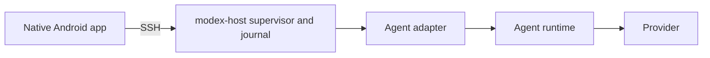

# Architecture

[English](architecture.md) · [Tiếng Việt](vi/architecture.md)

Modex uses a native Android client to control agent runtimes on a user's own host over SSH.

## Components

- **Android client:** Jetpack Compose UI for conversations, supported controls, and SSH connections.
- **SSH transport:** an SSH client in the Android app carries authenticated traffic to `modex-host` on the host.
- **Host supervisor and journal:** keeps the runtime bridge available across phone disconnects and replays bounded events on reconnect.
- **Adapter and runtime:** Codex, OpenCode, or Antigravity is selected for a conversation when supported and ready on that host.
- **Provider:** the agent runtime uses the host user's existing provider configuration and credentials.

Agent execution and provider credentials stay on the host. SSH protects transport; Modex does not provide end-to-end encryption beyond SSH. Android stores its connection state locally; see the [installation guide](install.md) and [mobile development notes](mobile-development.md) for operational details.

## Host platforms

Native host operations are supported on Linux and macOS. Windows host use currently runs inside WSL2; native Windows host service and CLI takeover are not supported. The Android app can connect to a reachable SSH host.
