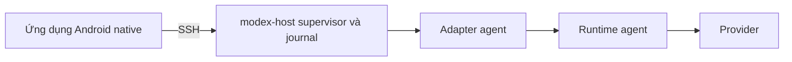

# Kiến trúc

[English](../architecture.md) · **Tiếng Việt**

Modex dùng ứng dụng Android native để điều khiển runtime agent trên host của người dùng qua SSH.

## Thành phần

- **Ứng dụng Android:** giao diện Jetpack Compose cho hội thoại, điều khiển được hỗ trợ và kết nối SSH.
- **Truyền tải SSH:** client SSH trong ứng dụng Android chuyển lưu lượng đã xác thực đến `modex-host` trên máy host.
- **Host supervisor và journal:** giữ cầu nối runtime hoạt động khi điện thoại ngắt kết nối và phát lại sự kiện còn trong giới hạn khi kết nối lại.
- **Adapter và runtime:** chọn Codex, OpenCode hoặc Antigravity cho hội thoại nếu runtime đó được hỗ trợ và sẵn sàng trên host.
- **Provider:** runtime agent dùng cấu hình và thông tin xác thực provider hiện có của người dùng trên host.

Việc chạy agent và thông tin xác thực provider nằm trên host. SSH bảo vệ đường truyền; Modex không cung cấp mã hóa đầu cuối vượt ngoài SSH. Android lưu trạng thái kết nối cục bộ; xem [hướng dẫn cài đặt](../install.md) và [ghi chú phát triển mobile](../mobile-development.md) để biết chi tiết vận hành.

## Nền tảng host

Các thao tác host native được hỗ trợ trên Linux và macOS. Hiện tại, dùng Windows làm host cần chạy bên trong WSL2; dịch vụ host và CLI takeover native trên Windows chưa được hỗ trợ. Ứng dụng Android có thể kết nối tới host SSH có thể truy cập.
